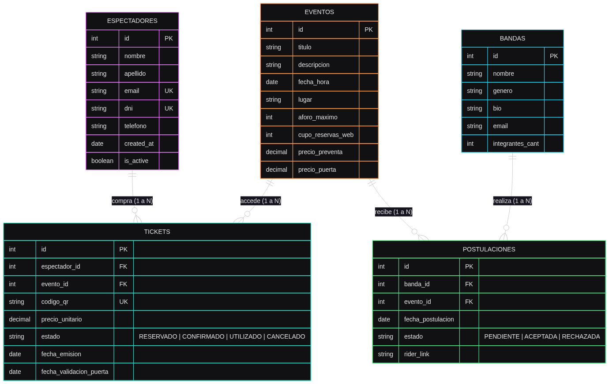

# Sistema de Gestión de Escena Musical Local — Backend (CircuitoVivo)

> Repositorio **backend** del proyecto final de carrera: un sistema de gestión para la escena musical local, incluyendo eventos, espectadores y emisión/validación de tickets. Este backend expone una API REST consumida por el frontend: [Frontend Repo](https://github.com/JulianRiedinger7/proyecto-final-tup-frontend)

## Diagrama Entidad-Relación Inicial



## Integrantes

- Julian Riedinger (GitHub: `@JulianRiedinger7`)
- Matias Ledesma Gonzalez (GitHub: `@Matiaslegon`)
- Clara Zivano (GitHub: `@clazlo`)

## Tecnologías y stack

| Área            | Tecnología         | Versión                               | Uso                                           |
| --------------- | ------------------ | ------------------------------------- | --------------------------------------------- |
| Runtime         | Node.js            | `>=20` (recomendado 22, ver `.nvmrc`) | Ejecución del servidor                        |
| Lenguaje        | TypeScript         | `^5.6.3`                              | Tipado estático y compilación a `dist/`       |
| Framework       | Express            | `^4.21.2`                             | API HTTP / routing                            |
| Validación      | Zod                | `4.6.5`                               | Validación de variables de entorno y requests |
| Package manager | pnpm               | `>=9` (recomendado `10.33.0`)         | Instalación reproducible vía `pnpm-lock.yaml` |
| Testing         | Vitest + Supertest | `^4.1.0` / `^7.1.4`                   | Tests unitarios y de integración HTTP         |
| Calidad         | Biome + Husky      | `2.5.15` / `9.1.7`                    | Lint, formato y hook `pre-commit`             |
| Env config      | dotenv             | `^16.4.7`                             | Carga de variables de entorno desde `.env`    |
| CORS            | cors               | `^2.8.5`                              | Control de orígenes permitidos                |
| Seguridad       | helmet             | `8.3.0`                               | Headers HTTP de seguridad                     |
| Logs HTTP       | morgan             | `1.12.1`                              | Log de peticiones (`dev` / `combined`)        |
| Dev runner      | tsx                | `^4.19.2`                             | `pnpm dev` con recarga (`tsx watch`)          |

## Requisitos previos

- **Git** (para clonar el repositorio)
- **Node.js `>=20`** (recomendado `22`, ver [`.nvmrc`](./.nvmrc))
- **pnpm `>=9`**

## Instalación y puesta en marcha

```bash
# 1. Clonar el repo
git clone https://github.com/JulianRiedinger7/proyecto-final-tup-backend.git
cd proyecto-final-tup-backend

# 2. Instalar dependencias EXACTAS del lockfile
pnpm install --frozen-lockfile

# 3. Configurar variables de entorno
## En Linux / MacOS
cp .env.example .env

## En Windows (PowerShell)
Copy-Item .env.example .env

# 4. Levantar el servidor en desarrollo
pnpm dev
```

La API queda disponible en `http://localhost:3000` (o el `PORT` configurado en `.env`).

### Variables de entorno

Definidas en [`.env.example`](./.env.example) y validadas al iniciar en [`src/config/env.ts`](./src/config/env.ts). El archivo `.env` no se versiona.

| Variable      | Default                 | Descripción                                                  |
| ------------- | ----------------------- | ------------------------------------------------------------ |
| `PORT`        | `3000`                  | Puerto HTTP donde escucha Express (`1` a `65535`).           |
| `NODE_ENV`    | `development`           | Entorno de ejecución (`development`, `test` o `production`). |
| `CORS_ORIGIN` | `http://localhost:5173` | Origen permitido por CORS para las peticiones del frontend.  |

### Persistencia actual

Los repositorios cargan los datos iniciales desde archivos JSON en [`data/`](./data/) (`eventos.json`, `espectadores.json` y `tickets.json`) y mantienen los cambios **en memoria** durante la ejecución. Al reiniciar el servidor, los datos vuelven al estado inicial de esos archivos.

## Estructura del repositorio

```text
├── .github/workflows/     # Workflows de Integración Continua (GitHub Actions)
├── data/                  # Datos iniciales en JSON (eventos, espectadores, tickets)
├── docs/                  # Documentación técnica y contrato de la API
├── src/
│   ├── config/            # Validación y carga de variables de entorno
│   ├── controllers/       # Adaptadores HTTP (request/response y delegación)
│   ├── errors/            # Errores de dominio con código HTTP asociado
│   ├── middlewares/       # Validación con Zod (validate) y manejo global de errores
│   ├── models/            # Tipos e interfaces de dominio
│   ├── repositories/      # Acceso a datos en memoria e interfaces (contratos)
│   ├── routes/            # Definición de rutas y middlewares por recurso
│   ├── schemas/           # Esquemas Zod para params, query y body
│   ├── services/          # Lógica y reglas de negocio (actualmente TicketService)
│   ├── utils/             # Helpers de fechas (zona horaria AR) y respuestas HTTP
│   ├── app.ts             # Configuración de Express, middlewares y montaje de rutas
│   └── server.ts          # Punto de entrada que inicia el servidor HTTP
└── tests/
    ├── unit/              # Tests unitarios aislados con repositorios mockeados
    └── integration/       # Tests de integración HTTP sobre App con Supertest
```

## Comandos del proyecto

### Desarrollo y build

```bash
pnpm dev           # Levanta la API en modo watch (tsx watch src/server.ts)
pnpm build         # Compila TypeScript en dist/
pnpm start         # Ejecuta el código compilado (node dist/server.js)
```

### Calidad, verificación y testing

```bash
pnpm check         # Validación completa local y en CI (format:check -> typecheck -> test)
pnpm lint          # Chequea lint y formato con Biome en todo el repo
pnpm lint:fix      # Aplica correcciones seguras y formatea con Biome
pnpm format:check  # Verifica lint, formato y orden de imports sin modificar archivos (biome ci)
pnpm typecheck     # Verifica tipos de TypeScript sin emitir archivos
pnpm test          # Corre toda la suite de tests una vez con Vitest
pnpm test:watch    # Corre Vitest en modo watch al modificar archivos
```

- **Validación unificada (`pnpm check`):** encadena `format:check`, `typecheck` y `test` deteniéndose ante el primer fallo. Conviene ejecutarlo antes de abrir un Pull Request.
- **Estilo de código y hook local:** configurado con **Biome 2.x** ([`biome.json`](./biome.json)). El hook `pre-commit` de **Husky** ejecuta `biome check --staged` y frena el commit si hay errores de lint o formato (extensión recomendada en VS Code: `biomejs.biome`, ver [`.vscode/extensions.json`](./.vscode/extensions.json)).
- **Tests (`tests/unit/` y `tests/integration/`):** no requieren levantar el servidor manualmente ni una base de datos externa. Los unitarios prueban reglas de negocio de `TicketService` aislando los repositorios con dobles (`vi.fn()`); los de integración prueban los endpoints reales de `App` mediante `Supertest`.

## Documentación de la API

La API expone sus recursos bajo el prefijo `/api/v1` (`/api/v1/health`, `/api/v1/eventos`, `/api/v1/espectadores`, `/api/v1/tickets`) utilizando el formato estándar `{ "msg": string, "code": number, "data"?: T }`.

El detalle completo de endpoints, parámetros, códigos de error y reglas de negocio por módulo se encuentra en [docs/api.md](./docs/api.md).

## Integración Continua (CI)

El workflow [`.github/workflows/ci.yml`](./.github/workflows/ci.yml) se ejecuta automáticamente en cada `push` y `pull_request` hacia `main` y `dev` sobre `ubuntu-latest`. Instala las dependencias con `pnpm install --frozen-lockfile` usando la versión de Node definida en [`.nvmrc`](./.nvmrc) y corre `pnpm check` seguido de `pnpm build` para detectar errores antes de integrar cambios.

## Estado Actual del Proyecto

- [x] Modelo de datos inicial (ER) definido y documentado.
- [x] CRUD de Tickets, Eventos y Espectadores implementado utilizando una arquitectura en capas.
- [x] Persistencia inicial en memoria cargada desde archivos JSON (`data/`).
- [x] Reglas de negocio y tests unitarios y de integración para Tickets.
- [x] Validación local unificada (`pnpm check`) e Integración Continua con GitHub Actions.
- [ ] Reglas de negocio y tests para Eventos y Espectadores.
- [ ] Colección de Postman / especificación OpenAPI formal.
- [ ] Migración a base de datos real.
